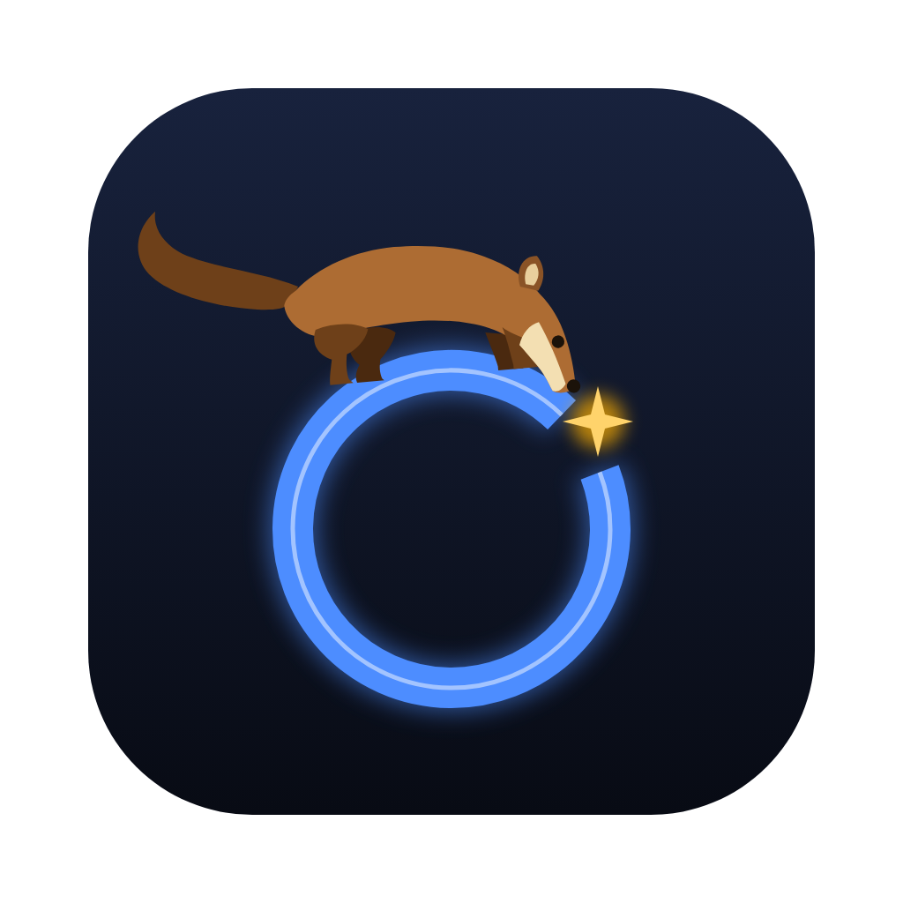
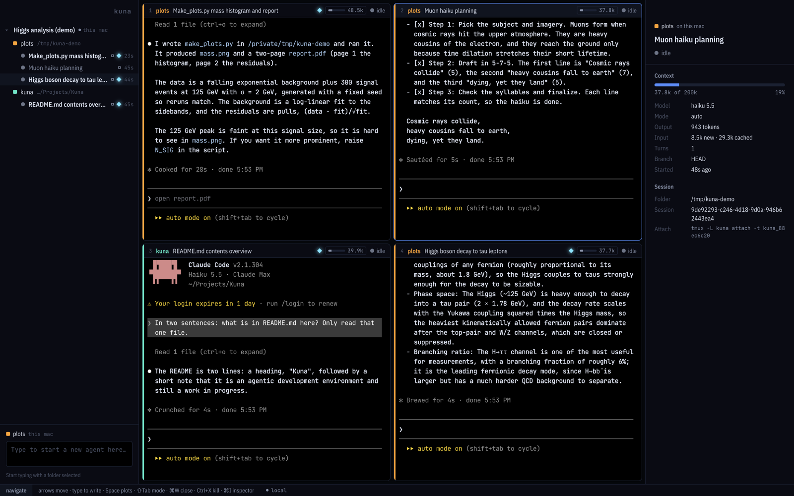
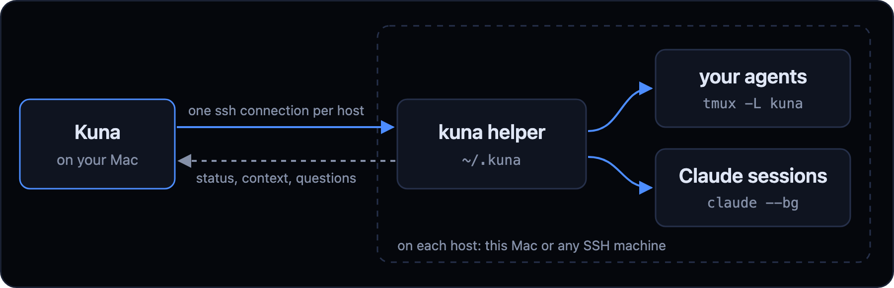
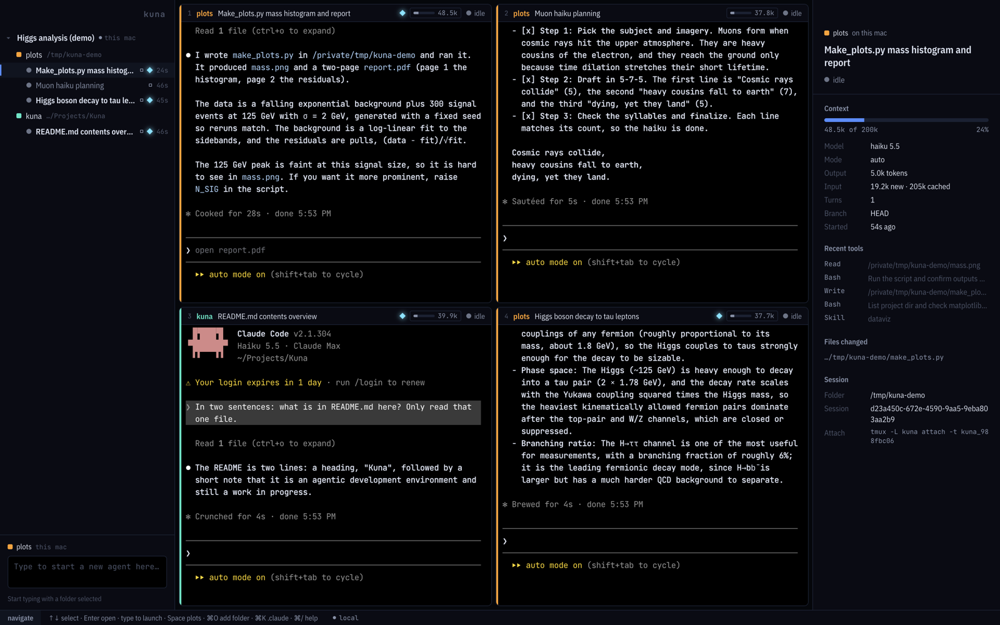
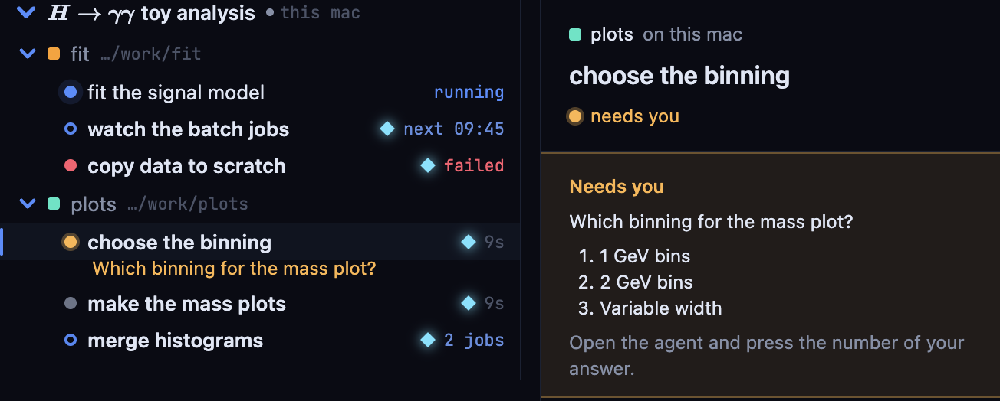
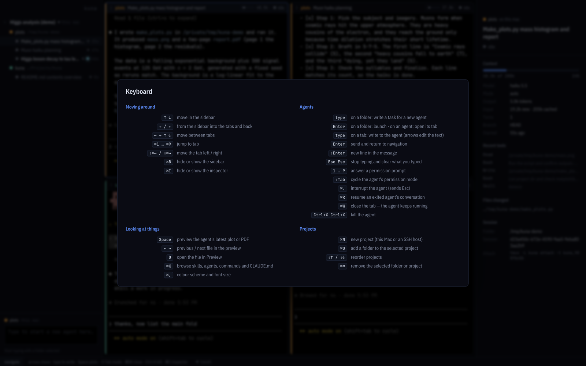
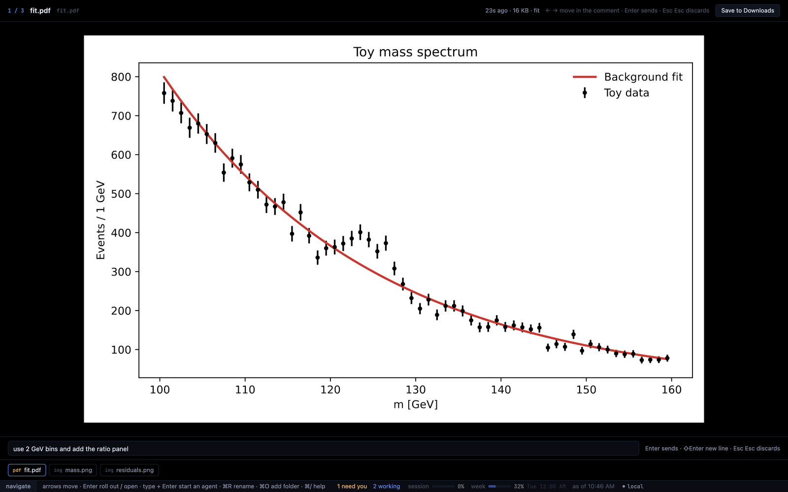
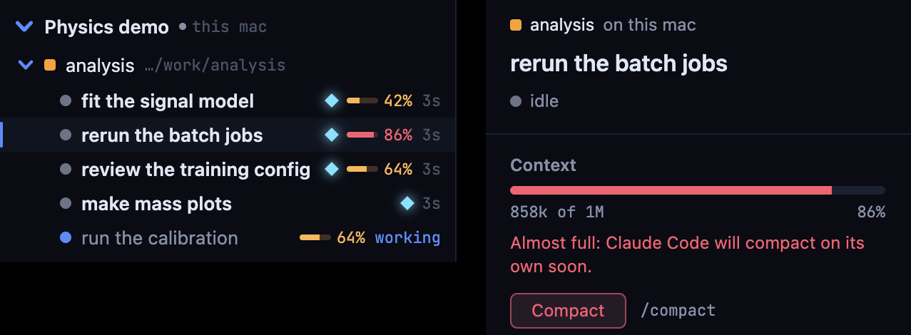

<p align="center">
  
</p>

<h1 align="center">Kuna</h1>

<p align="center">
  <b>A keyboard-first control room for coding agents, on your Mac and on any SSH host.</b><br>
  Run a dozen Claude Code agents side by side; they keep working in tmux when you close the laptop.
</p>

<p align="center">
  <a href="#install">Install</a> · <a href="#how-it-works">How it works</a> · <a href="#features">Features</a> · <a href="docs/KEYBOARD.md">Shortcuts</a> · <a href="SECURITY.md">Security</a>
</p>

<p align="center">
  
  
  
</p>



## How it works



- **Agents live on their host, in tmux.** Kuna installs one small shell script in `~/.kuna` and starts each agent in its own tmux server there. Quit Kuna, lose Wi-Fi, close the laptop: the agents keep going, and Kuna picks them up again.
- **One quiet ssh stream per host** reports what every agent is doing, whether it needs you and how full its context is, from Claude Code's own hooks and transcripts. No cloud service in between; your `~/.ssh/config`, keys and jump hosts work as in a terminal.
- **Panes are the real thing:** each is a terminal attached to the agent, so you see and type into Claude Code exactly as in iTerm.

## Features

### Projects → folders → agents
Group agents by host and repository. Pick a folder, type the task, press Enter: a new agent opens in a pane and the panes re-tile themselves.



### Your Claude background sessions, too
Everything started with `claude --bg` shows up under its folder with what it's doing and the question it's waiting on. Answer with a number key without opening it.



### Keyboard first
Arrows move between the sidebar and the panes, typing talks to the focused agent, Esc Esc stops. Everything else is one shortcut away: ⌘/ lists them. ⇧⌘N opens another window with its own panes and the same sidebar; ⌘← ⌘→ jump between windows.



### Plots, PDFs and notes on Space
The figures from the agent's latest reply, PDFs first, sharp and zoomable, and the Markdown files it wrote, rendered with their pictures, LaTeX and flowcharts. Each pane counts them in its header. The agent sits beside the file, under a list of all of them: read what it said and type your reply right there; ⌘S saves the file.



### Status you can trust
Working, waiting on a job, needs you, idle or failed, and what it's running right now. Context gauges warn before Claude Code compacts on its own, and your plan usage sits in the status bar.



**Also in the box:** a browser for `.claude` skills, agents and settings (⌘K) · six dark colour schemes · LaTeX in project names · drag to arrange · your iTerm2 and VS Code fonts · open panes come back after a restart · gentle on shared cluster login nodes.

## Install

You need macOS 13+, Node.js 22.12+, the Xcode command line tools, `tmux` and Claude Code (signed in). Remote hosts need `tmux`, `claude` and a POSIX `sh`.

```sh
git clone https://github.com/jansam123/kuna.git && cd kuna
npm install      # also builds the terminal library for Electron
npm run dev      # run it
npm run dist     # or build release/mac-arm64/Kuna.app
```

Setting it up with a coding agent? Point it at [CLAUDE.md](CLAUDE.md).

**On Windows** agents on this PC run in WSL, and ⌘ shortcuts are Ctrl+Shift: see [Windows](docs/WINDOWS.md).

**First steps:** ⌘N creates a project (this Mac or an SSH host) · ⌘O adds a folder · type a task and press Enter · Space shows its plots · ⌘/ shows every shortcut.

## Docs

[Keyboard](docs/KEYBOARD.md) · [Remote hosts](docs/REMOTE-HOSTS.md) · [Windows](docs/WINDOWS.md) · [Architecture](docs/ARCHITECTURE.md) · [Themes](docs/THEMES.md) · [Development](docs/DEVELOPMENT.md) · [Security](SECURITY.md)

## Why "Kuna"?

*Kuna* is Slovak for marten. In 2016 one got into a transformer at CERN and stopped the LHC; that's the marten in the logo.

## License

[MIT](LICENSE)
