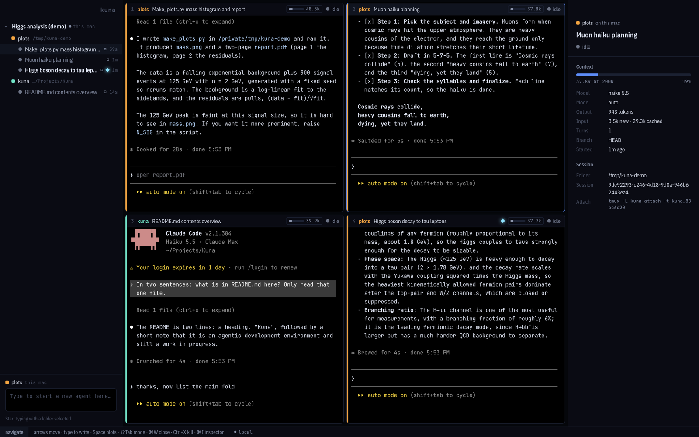
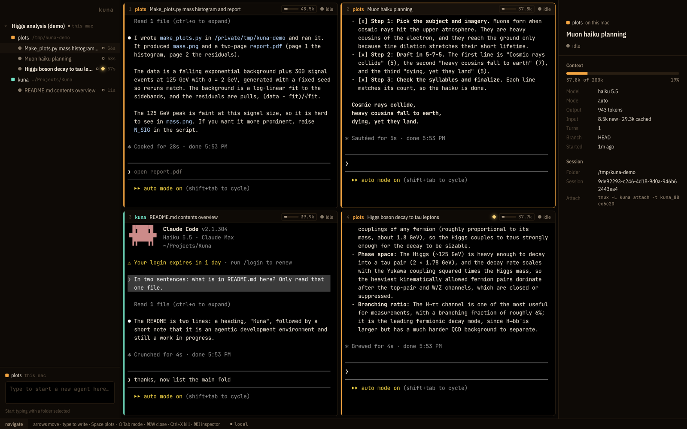
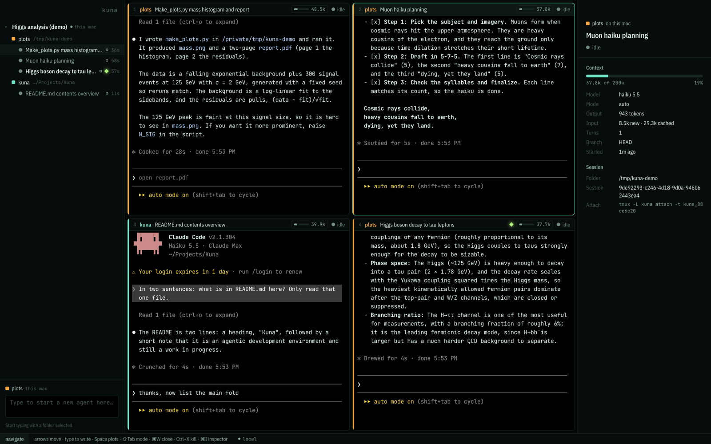
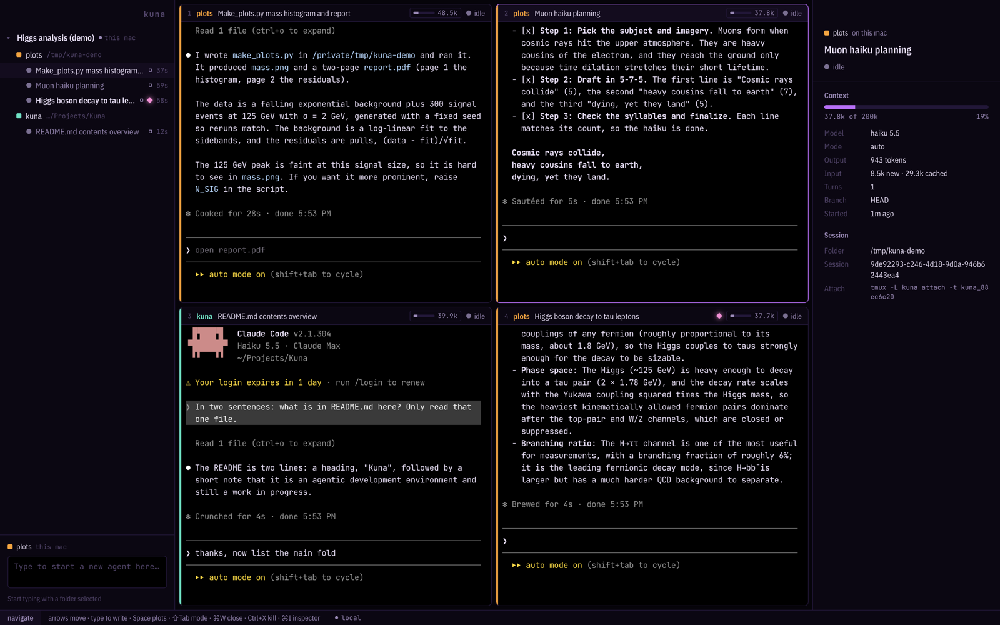
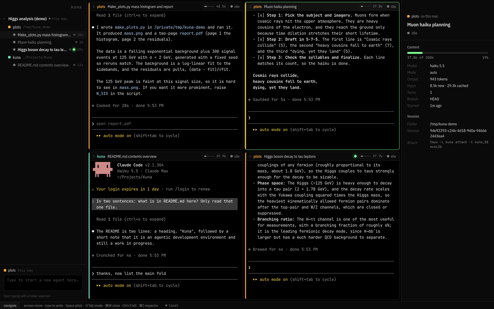

# Colour schemes

Every scheme follows the same rules, so you can switch without relearning anything:

- **Terminals are pure black** (`#000`). Agent output keeps standard ANSI colours.
- **The chrome is a tinted near-black** one or two steps above black, so panes read as windows sitting on a surface.
- **One accent family** marks focus and selection; a second hue marks **typing mode**, so you always know whether keys go to an agent.
- **Status and notification colours are the same in every scheme**, so they never mix with a scheme's accent: blue `#4d8dff` working (a hollow blue ring: waiting on a job of its own), amber `#ffb547` needs you, grey `#6b7488` idle, red `#ff5a6e` failed, hollow `#3a4152` stopped, cyan `#6fe3ff` unread.
- **Project and folder colours** (the rail on each pane, the square next to each folder) are the same 24 hues in every scheme, so a repo keeps its colour when you switch.

Switch with **⌘,** — ↑ ↓ previews live.

## Cherenkov (default)

Blue glow on black, after the light in a water Cherenkov detector. Calm and cool; the most legible for long sessions.

| Role | Colour |
| --- | --- |
| ground / panel / raised | `#05070c` `#090c14` `#0f1420` |
| accent (focus, selection) | `#4d8dff` |
| typing | `#a78bff` |

## Calorimeter

Amber energy deposits. Warm and high-contrast; the warmest of the six.

| Role | Colour |
| --- | --- |
| ground / panel / raised | `#090604` `#0f0a06` `#18110a` |
| accent | `#ff9f1c` |
| typing | `#ff5d3a` |

## Tracker

Teal tracks through silicon. Crisp and technical.

| Role | Colour |
| --- | --- |
| ground / panel / raised | `#030807` `#060e0c` `#0b1714` |
| accent | `#2ee6c5` |
| typing | `#9bf26a` |

## Muon

Violet and magenta. Moody, while status still stands out.

| Role | Colour |
| --- | --- |
| ground / panel / raised | `#07040b` `#0c0713` `#140c1f` |
| accent | `#c26bff` |
| typing | `#ff6bc1` |

## Phosphor

Neutral grey chrome with a single P1-green signal. The least colour noise; good if your agents' output is already colourful.

| Role | Colour |
| --- | --- |
| ground / panel / raised | `#050505` `#0a0a0a` `#121212` |
| accent (focus, selection) | `#39ff88` |
| typing | `#e6e6e6` |

## Black

Black with plain, untinted greys: light grey text, darker grey for secondary text and lines, a grey accent. Colour is left to status and your project colours.

| Role | Colour |
| --- | --- |
| ground / panel / raised | `#000000` `#000000` `#141414` |
| text / secondary / lines | `#d4d4d4` `#9a9a9a` `#262626` |
| accent | `#a8a8a8` |

## Adding a scheme

Schemes live in `src/renderer/src/themes.ts`. Add an object to `THEMES` with the chrome colours, `...STATUS_COLORS` (status colours are shared) and an xterm `terminal` palette (keep `background: '#000000'`). It appears in **⌘,** immediately in `npm run dev`.

Typography follows your own tools, not the scheme. Kuna's interface uses VS Code's: the system font at VS Code's 13 px, and your `editor.fontFamily` / `editor.fontSize` for paths and numbers (read from VS Code's `settings.json`, including `window.zoomLevel`). Agent panes use the font Claude Code runs in for you: the default iTerm2 profile's font, size and spacing, or VS Code's `terminal.integrated.*` settings without iTerm2. **⌘,** shows what was found, changes the agent font size (⌘+ / ⌘− anywhere) and can switch the interface to your editor font.
